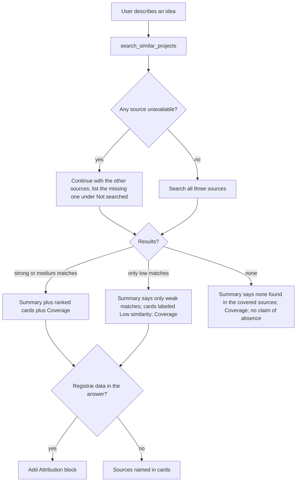
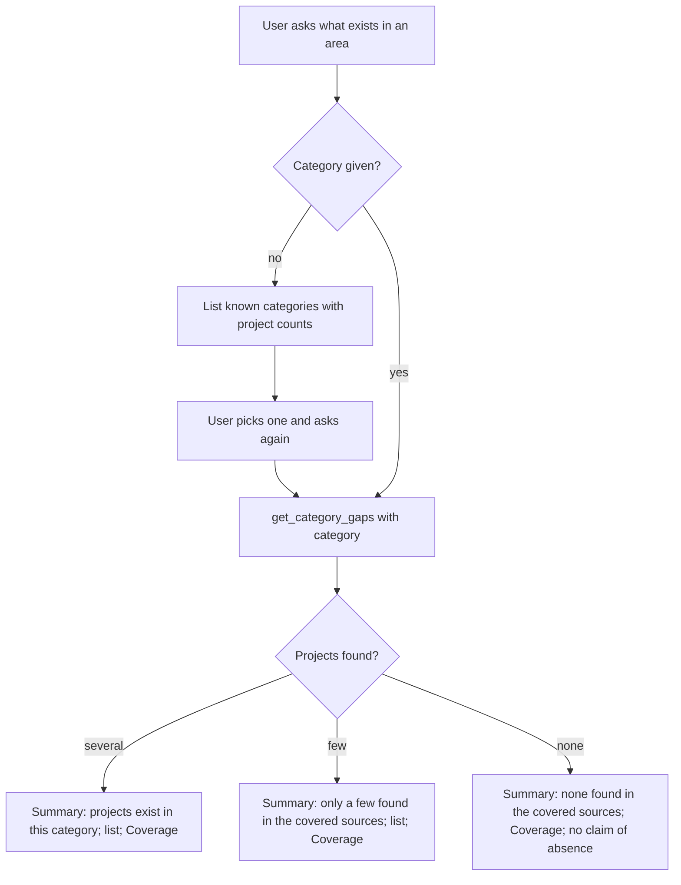
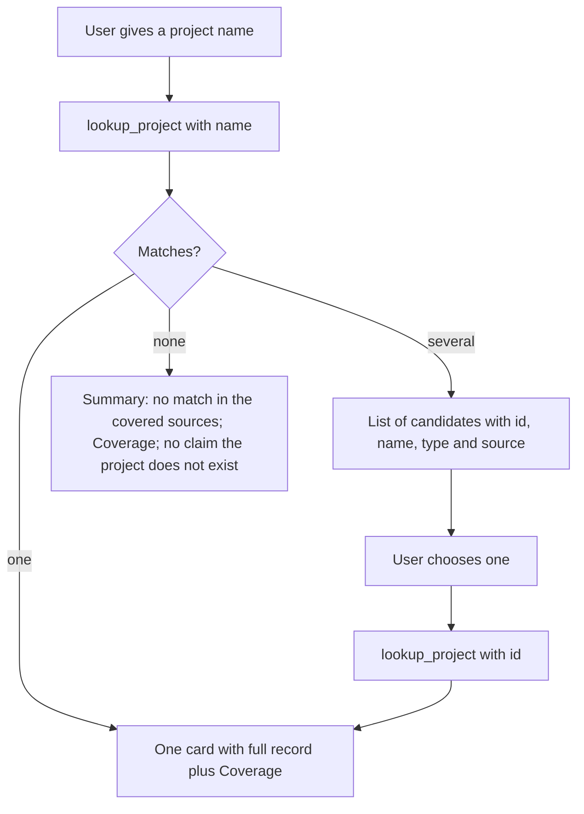
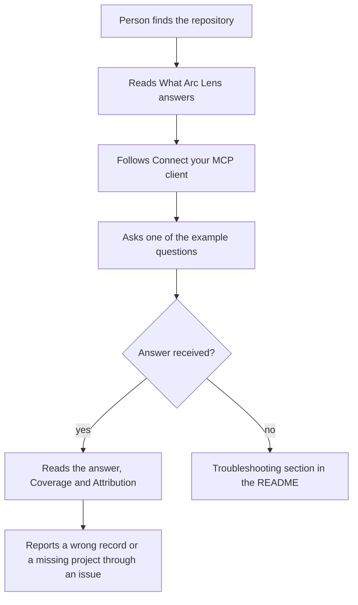
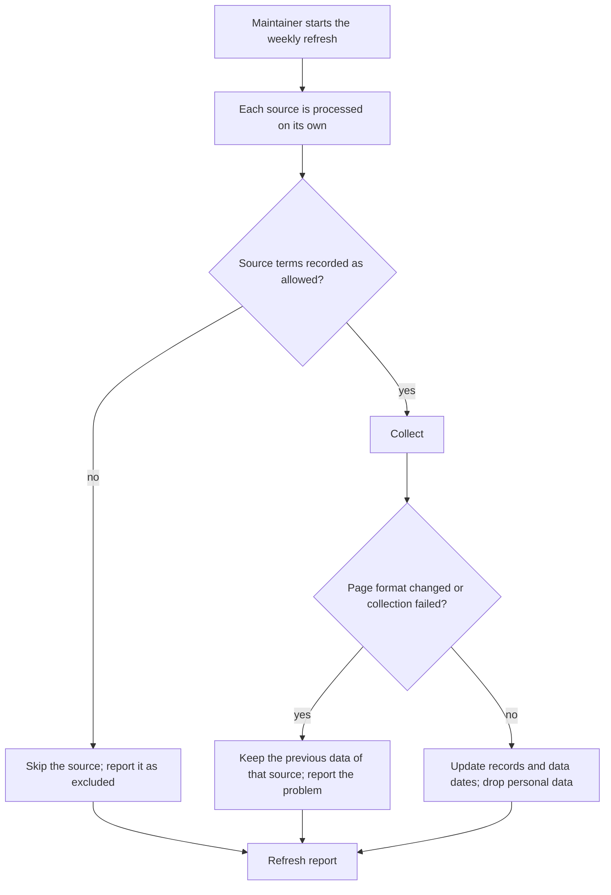

# Arc Lens: product

Stage: Product. Source: [docs/01-requirements.md](01-requirements.md). This document defines the flows, the minimum interactions and the texts of Arc Lens. It does not define the transport, hosting, storage, similarity method or tool schemas: those are Architecture decisions. Where a decision is a Product proposal that the owner has not confirmed, it is marked as a premise and listed in section 10.

References: US-xx (user stories), BRx (business rules), NFR-xx (non-functional requirements), Qxx (open questions).

## 1. What "the interface" is

Arc Lens is an MCP server and an open dataset. It has no graphical screens in v1. A person or an agent meets the product in three places:

| Surface | Who uses it | What it is |
|---|---|---|
| Tools | An agent, or a person through an MCP client | Three tools that return answers: search for similar projects, gaps by category, look up a project |
| Answers | Both | The text and structured data the tools return. This is the product's "screen" |
| README | A person deciding whether to install it | The only onboarding surface: what it answers, how to connect, example questions, sources and attribution |

A fourth, maintainer-only surface is the refresh report (section 6.5).

Because an agent reads the answer as well as a person, every answer is written once, as plain text with a fixed structure, and the structured data carries exactly the same facts (US-08: the same content for a person and for an agent).

## 2. Design principles

1. **Never claim absence.** A false "nothing similar exists" is the worst error (NFR-02). Every answer says what was searched, and an empty result is worded as "not found in the covered sources", never as "does not exist".
2. **Say how old and where from.** Every project carries its source link and data date (BR4), and every answer shows the dataset age (US-10, NFR-01).
3. **Degrade visibly.** When a source is down, the answer still returns the rest and names the part that is missing (US-03, NFR-03).
4. **Unknown is not no.** A winner flag or a live status that cannot be determined is shown as "Unknown", never as "No" or "Not live" (US-01, US-07).
5. **Same shape every time.** The order of sections and the labels never change, so an agent can quote an answer and a person can scan it.
6. **Short first.** One summary line before the list; no more results than the default limit unless asked (Q11).
7. **Plain text.** No dependence on color, emoji, tables or images. Links are full URLs. Dates are `YYYY-MM-DD`.

## 3. Tools

Names and parameters below are the Product proposal; the final schemas belong to Architecture.

### 3.1 `search_similar_projects` (US-04, US-05)

When to use: the user describes an idea for Arc and wants to know who built something similar.

| Parameter | Required | Description |
|---|---|---|
| `idea` | yes | A description of the idea in a few sentences |
| `limit` | no | Maximum number of results. Premise: default 5, maximum 10 (Q11) |

Returns: the shared answer structure (section 4) with a ranked list of similar projects from the hackathon dataset, the grant dataset and Registrai.

### 3.2 `get_category_gaps` (US-06)

When to use: the user wants to know what exists on Arc in an area, and whether the area looks unserved.

| Parameter | Required | Description |
|---|---|---|
| `category` | no | The area to inspect, for example "payments for AI agents". When omitted, the tool returns the list of known categories with a project count for each, so the user can pick one. Premise: free text plus a known list (Q8) |

Returns: the projects found in the category, a statement of whether no project was found in the covered sources or only a few, and the coverage the statement is based on.

### 3.3 `lookup_project` (US-15, US-07)

When to use: the user already has a project name and wants its record.

| Parameter | Required | Description |
|---|---|---|
| `name` | yes, unless `id` is given | The project name |
| `id` | no | The stable identifier of a candidate returned by an earlier lookup, used to choose among several matches |

Returns: the project record, or the candidates to choose from, or a "no match" answer with the coverage.

### 3.4 Tool descriptions as texts

Agents choose tools from their descriptions, so the descriptions are part of the interface. Proposed texts (in English, under 300 characters each):

- `search_similar_projects`: "Find Arc projects similar to an idea: hackathon entries, Circle grant recipients and the Registrai directory. Returns each match with prize or grant, live status, source link and data date, plus what was searched. Never concludes that nothing exists on Arc."
- `get_category_gaps`: "Show what exists on Arc in a category and whether the area looks unserved. Without a category, lists the known categories. Reports coverage and data dates with every answer."
- `lookup_project`: "Read the full record of an Arc project by name: description, source, prize or grant, live status and evidence. If several projects match, returns candidates to choose from."

## 4. Shared answer structure

Every answer has the same sections in the same order. Sections that do not apply are omitted, except Coverage, which is always present.

```
1. Summary         one line: what was asked and what was found
2. Results         the list of project cards (or candidates)
3. Coverage        sources searched, sources not searched, data dates
4. Attribution     only when Registrai data is in the answer
```

### 4.1 Project card

Each project is shown with the same fields, in this order:

| Field | Values | Notes |
|---|---|---|
| Name | text | |
| Similarity | High, Medium, Low | Only in search answers. Low matches are shown and labeled, never hidden (US-05). Thresholds are Q9 |
| Type | Hackathon project, Grant recipient, Directory entry | With the hackathon or cohort name |
| Prize or grant | Winner, Not a winner, Unknown; or the grant and its date | A hackathon page that does not say who won gives Unknown (US-01) |
| Status | Live, Not live, Unknown | Always with the evidence used, for example "demo responds, last commit 2026-11-02". How it is decided is Q3 (US-07) |
| Description | one or two sentences | Project-level only; no team member names or contacts (BR1, US-12) |
| Source | source name, full URL, data date | Required on every card (BR4) |

Onchain volume appears on a card only when it comes from Registrai, and then it carries the Registrai attribution marker (BR2).

### 4.2 Coverage block

```
Coverage
Searched: <source> (data date <date>); <source> (data date <date>)
Not searched: <source> (<reason>)    [omitted when everything was searched]
Dataset updated: <date>
```

The Coverage block is what an agent should quote when it tells the user that nothing was found. It always lists the data dates (US-05, US-06, US-10).

### 4.3 Attribution block

Present whenever the answer contains Registrai data (BR2, US-09). Draft text, to be checked against Registrai's attribution terms (P2):

"Directory and onchain volume data: Registrai (https://builder.registrai.cc), licensed under CC BY 4.0 (https://creativecommons.org/licenses/by/4.0/). Queried live for this answer."

Answers that use only the hackathon and grant datasets name those sources and their links in the cards and the Coverage block instead (US-09).

## 5. Flows

### F1. Check an idea (US-04, US-05, US-09)



Rules:

- The search never fails as a whole because one source failed. It returns what it has and says what is missing (NFR-03).
- The summary line states the number of results and how many sources were searched, for example "3 similar projects found across 3 sources."
- The empty answer always lists what was searched and its data dates, and never says that nothing exists on Arc (US-05).

### F2. Find the gap (US-06)



Rules:

- The statement about an area is always one of three fixed sentences: "Several projects found", "Only a few projects found in the covered sources", "No project found in the covered sources". Never "empty" or "nobody built this" (NFR-02).
- The answer is ready to quote: the summary line and the Coverage block together make sense without the list (US-06).
- The thresholds for "several" and "a few" are an Architecture and owner decision with the categories (Q8).

### F3. Look up a project (US-15, US-07)



Rules:

- With several matches the tool never guesses. It lists candidates, each with a stable `id`, the name, the type with the hackathon or cohort, and the source (US-15).
- The full record shows everything in the project card plus the evidence behind the status (US-07).

### F4. First use: from README to first answer (US-13, US-08)



The README is the whole onboarding; there is no setup screen, account or sign-in in v1.

### F5. Refresh and report (US-10, US-11, US-12; maintainer)



## 6. Interaction specification

All examples below use made-up projects and example URLs. They show structure and wording, not real data.

### 6.1 Similarity search answer

Example data:

```
Similar projects for: "a marketplace where AI agents pay each other in USDC for data"

3 similar projects found across 3 sources.

1. ExampleMarket (similarity: High)
   Type: Hackathon project, Example Hackathon, Arc track
   Prize or grant: Winner
   Status: Live (demo responds; last commit 2026-11-02)
   Description: Agents list and buy datasets, paying per request in USDC.
   Source: Example Hackathon showcase, https://example.com/showcase/examplemarket, data date 2026-11-10

2. ExamplePay (similarity: Medium)
   Type: Grant recipient, Example cohort 2026
   Prize or grant: Grant, 2026-03
   Status: Unknown (no recent public activity found)
   Description: Payment rails for software agents.
   Source: Example grant announcement, https://example.com/grants/2026, data date 2026-11-10

3. ExampleDex (similarity: Low)
   Type: Directory entry
   Prize or grant: Unknown
   Status: Live (onchain activity in the last 30 days)
   Description: Token swaps between stable assets.
   Source: Registrai directory, https://builder.registrai.cc, data date 2026-11-14

Coverage
Searched: hackathon dataset (data date 2026-11-10); grant dataset (data date 2026-11-10); Registrai directory (queried 2026-11-14)
Not searched: none
Dataset updated: 2026-11-10

Attribution
Directory and onchain volume data: Registrai (https://builder.registrai.cc), licensed under CC BY 4.0 (https://creativecommons.org/licenses/by/4.0/). Queried live for this answer.
```

### 6.2 Nothing similar found

```
Similar projects for: "<idea>"

No similar projects found in the covered sources. This does not mean that nothing like it exists on Arc.

Coverage
Searched: hackathon dataset (data date 2026-11-10); grant dataset (data date 2026-11-10); Registrai directory (queried 2026-11-14)
Not searched: none
Dataset updated: 2026-11-10
```

With only weak matches, the summary changes to "Only weak matches found. They are shown below and labeled Low similarity." and the cards follow.

### 6.3 One source unavailable

```
Coverage
Searched: hackathon dataset (data date 2026-11-10); grant dataset (data date 2026-11-10)
Not searched: Registrai directory (unavailable at query time)
Dataset updated: 2026-11-10
```

The summary adds one sentence: "The Registrai part is unavailable, so directory and volume data are missing from this answer."

### 6.4 Lookup with several matches

```
Several projects match "Example": choose one and look it up again with its id.

1. id: hack-0042   ExampleMarket, Hackathon project, Example Hackathon (source: Example Hackathon showcase)
2. id: grant-0007  ExamplePay, Grant recipient, Example cohort 2026 (source: Example grant announcement)

Coverage
Searched: hackathon dataset (data date 2026-11-10); grant dataset (data date 2026-11-10); Registrai directory (queried 2026-11-14)
Not searched: none
Dataset updated: 2026-11-10
```

### 6.5 Refresh report (maintainer)

```
Refresh report, 2026-11-17

Updated: 2 sources, 41 records added, 12 records changed
Failed: 1 source (page format changed; previous data kept)
Excluded: 1 source (terms of use forbid automated collection)
Personal data dropped at collection: yes
Dataset updated: 2026-11-17
```

A source that changed format is named in the report. The refresh never returns less data without saying so (US-10).

### 6.6 Stale data

When the dataset is older than the expected weekly cycle, every answer adds one line under Coverage: "The dataset is older than expected (last update 2026-10-20); recent projects may be missing." The threshold is premise P1.

## 7. README specification (US-13)

Sections, in this order. The README is written in English.

| Order | Section | Content |
|---|---|---|
| 1 | Title and one sentence | "Arc Lens answers one question for builders on Arc: has this idea already been built, by whom, did it win a prize or a grant, is it live, and where are the gaps." |
| 2 | What you get | The three tools in one line each, and the answer structure in four bullets (summary, results, coverage, attribution) |
| 3 | Connect your MCP client | The connection steps. The exact commands depend on the delivery mechanism (Architecture decision) |
| 4 | Try it | Five example questions (below) |
| 5 | How to read an answer | The project card fields and the meaning of High, Medium and Low similarity, Winner, Unknown, Live |
| 6 | Data sources and attribution | The sources, their data dates, and the Registrai CC BY 4.0 attribution text |
| 7 | Coverage and freshness | Weekly refresh, how to read the dataset date, what is not covered |
| 8 | What Arc Lens does not do | Docs and code skills (links to the official docs MCP and `circlefin/skills`), other chains, payments |
| 9 | Report a wrong or missing project | Link to the issue template; project-level data only, no personal data |
| 10 | License and contributing | The dataset license (Q10) and how to contribute |

Example questions:

1. "I want to build a payment app for AI agents on Arc. Has anyone built something similar?"
2. "Which Arc hackathon projects around stablecoin FX won a prize?"
3. "What exists on Arc in cross-border payroll, and does the area look unserved?"
4. "Look up the project ExampleMarket."
5. "Which Circle grant recipients work on agent payments, and are they still live?"

Statement for section 8: "Arc Lens never tells you that nothing exists on Arc. It tells you what it searched and when the data was collected."

## 8. Texts

### 8.1 Fixed sentences

| Id | Situation | Text |
|---|---|---|
| T-01 | Search summary, results found | `N similar projects found across M sources.` |
| T-02 | Search, only weak matches | `Only weak matches found. They are shown below and labeled Low similarity.` |
| T-03 | Search, nothing found | `No similar projects found in the covered sources. This does not mean that nothing like it exists on Arc.` |
| T-04 | Gaps, several | `Several projects found in this category.` |
| T-05 | Gaps, few | `Only a few projects found in this category in the covered sources.` |
| T-06 | Gaps, none | `No project found in this category in the covered sources. This does not mean that nobody has built something in this area.` |
| T-07 | Gaps, no category given | `Known categories, with the number of projects in each. Ask again with one of them.` |
| T-08 | Lookup, several matches | `Several projects match "<name>": choose one and look it up again with its id.` |
| T-09 | Lookup, no match | `No project named "<name>" found in the covered sources. This does not mean that the project does not exist.` |
| T-10 | Source unavailable | `The <source> part is unavailable, so <what is missing> is missing from this answer.` |
| T-11 | Stale data | `The dataset is older than expected (last update <date>); recent projects may be missing.` |
| T-12 | Winner flag unknown | `Prize or grant: Unknown` |
| T-13 | Status unknown | `Status: Unknown (<evidence or "no evidence found">)` |
| T-14 | Empty `idea` | `Describe your idea in a few sentences, for example what it does and who uses it.` |
| T-15 | Unknown `id` | `No project with this id. Run the lookup again with the project name.` |

### 8.2 Labels

`Similarity`, `Type`, `Prize or grant`, `Status`, `Description`, `Source`, `Coverage`, `Searched`, `Not searched`, `Dataset updated`, `Attribution`, `Winner`, `Not a winner`, `Unknown`, `Live`, `Not live`, `High`, `Medium`, `Low`. The labels are fixed: they are never translated or reworded between answers.

### 8.3 Tone

Direct, factual, short. No marketing wording, no exclamation marks, no emoji. Uncertainty is stated as uncertainty ("Unknown", "not found in the covered sources"), not softened with "probably".

## 9. Usability and accessibility

| Area | Specification |
|---|---|
| Readability by people | Plain text with short lines; one project per block; labels at the start of each line; no tables or color needed to read an answer |
| Readability by agents | Same facts in the structured data and in the text; fixed labels and section order; the Coverage block is quotable as it stands (US-08) |
| Screen readers | The answer is text, so a screen reader reads it in order. Links are full URLs with no "click here" text |
| Language | English for all answers and the README. The language of the query is Q12; until it is decided, only English queries are guaranteed to work |
| Dates | `YYYY-MM-DD` everywhere, with no relative dates like "yesterday" |
| Length | A default of 5 results keeps an answer short enough to read in one screen (Q11) |
| Speed | The answer arrives within seconds (NFR-06). When the client supports it, a progress indication is shown during a search. The numeric target is Q6 |
| Errors | An error says what happened and what to do next, in one or two sentences, with no stack traces or internal codes |
| Personal data | A card never shows team member names or contacts, even when the source page lists them (BR1, US-12) |

## 10. Open questions that touch the interaction

Questions from `01-requirements.md` with their effect on the interaction and the premise used until the answer:

| Id | Question | Affects | Premise used |
|---|---|---|---|
| Q3 | How a project is decided to be live | Status field, evidence text | Status is Live, Not live or Unknown, always with evidence |
| Q6 | The numeric target for "within seconds" | NFR-06, progress indication | No number is promised in the README |
| Q7 | How much Arc-specific knowledge answers carry | Answer content | None in v1 beyond links to the official docs |
| Q8 | Categories for the gaps view and who defines them | `get_category_gaps` | Free text plus a list of known categories |
| Q9 | How similarity is judged and the cutoff for hiding matches | Similarity labels | High, Medium and Low; nothing hidden |
| Q10 | The dataset license | README section 10 | Left as a placeholder |
| Q11 | Number and order of results | `limit`, answer length | Default 5, maximum 10, ranked by similarity |
| Q12 | Language of the query and the answer | Tools, README | English guaranteed; other languages not promised |

New questions from Product:

| Id | Question | Affects | Premise used |
|---|---|---|---|
| P1 | When is the dataset considered stale and the warning shown? | Text T-11 | More than 14 days since the last update |
| P2 | Is the draft attribution wording enough for Registrai's CC BY 4.0 terms? | Attribution block, README section 6 | The draft in section 4.3, to be checked against Registrai's terms |
| P3 | Should the gaps tool list the known categories when no category is given? | `get_category_gaps` | Yes; it is needed to choose a category without guessing |

## 11. Traceability

| Story | Tool or surface | Flow |
|---|---|---|
| US-01, US-02 | Project card fields (Type, Prize or grant) | F1, F3 |
| US-03 | Source unavailable handling, Attribution block | F1 |
| US-04 | `search_similar_projects` | F1 |
| US-05 | Coverage block, T-02, T-03 | F1 |
| US-06 | `get_category_gaps` | F2 |
| US-07 | Status field with evidence | F1, F3 |
| US-08 | All tools, same facts in text and structured data | F1, F2, F3 |
| US-09 | Attribution block, source line on each card | F1 |
| US-10 | Dataset updated line, T-11, refresh report | F5 |
| US-11 | Refresh report (Excluded) | F5 |
| US-12 | Card fields without personal data, refresh report | F5 |
| US-13 | README | F4 |
| US-14 | Not a product surface; outreach only | none |
| US-15 | `lookup_project` | F3 |

| Requirement | Where it is met |
|---|---|
| BR1 | Card fields; refresh drops personal data (F5) |
| BR2 | Attribution block (section 4.3) |
| BR3 | Registrai data queried live and not stored (F1) |
| BR4 | Source and data date on every card |
| NFR-02 | Principle 1; T-03, T-06, T-09 |
| NFR-03 | Principle 3; T-10 |

## 12. Out of this stage

Not defined here because they belong to other stages: the transport and hosting, the tool schemas and identifiers, the similarity method, the storage of the dataset, the way the maintainer starts a refresh, the final dataset license, and anything in the out-of-scope list of the requirements (docs and code skills, partner matching, personas, content indexing, views for Circle's team, payments, other chains).
