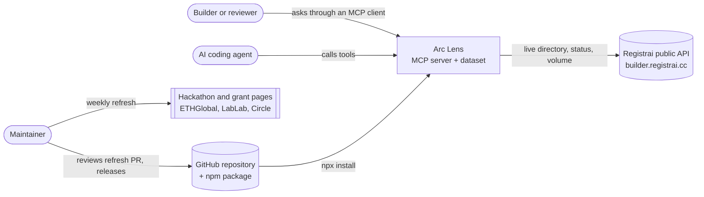
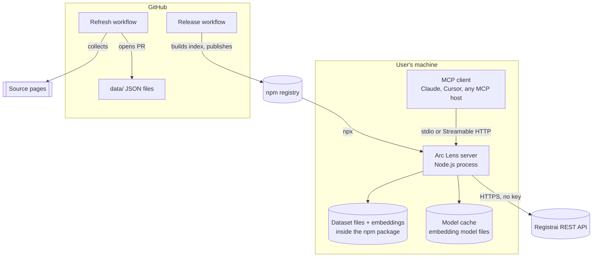
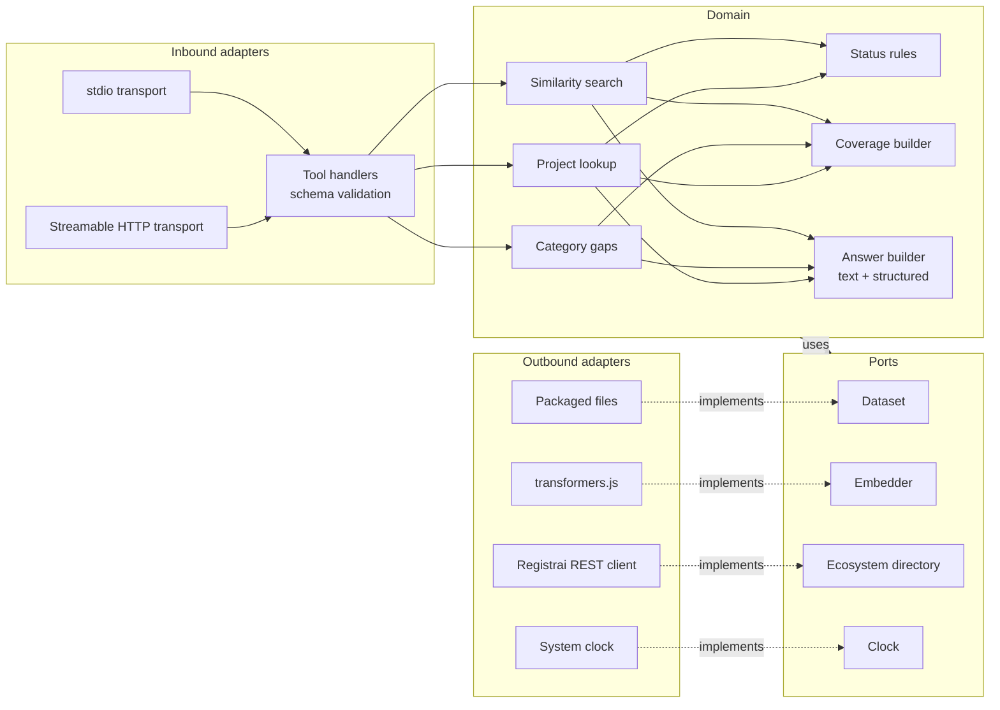
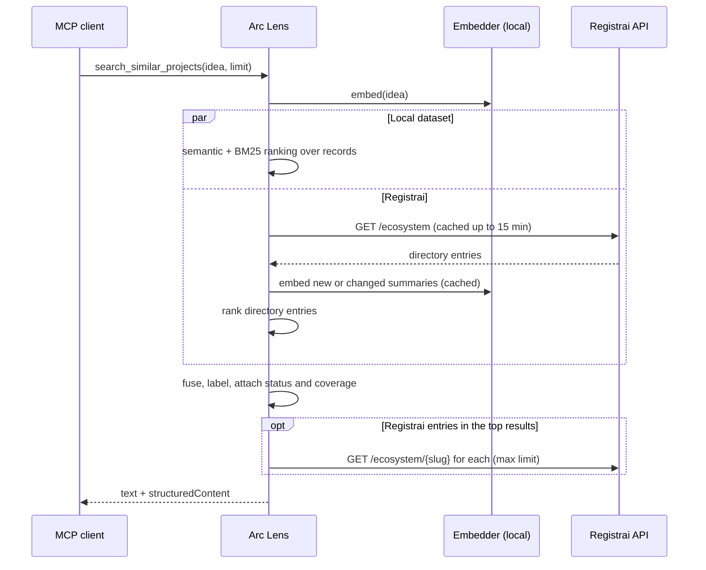
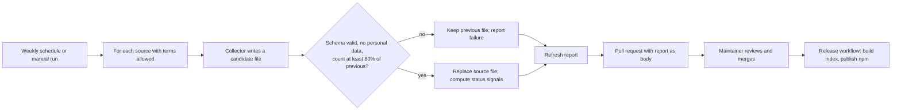

# Arc Lens: architecture

Stage: Architecture. Sources: [docs/00-idea.md](00-idea.md), [docs/01-requirements.md](01-requirements.md) (PR #2) and docs/02-product.md (PR #3, read from the branch `docs/02-product`). This document defines the components, data, tool contracts, infrastructure and the answers to the open questions that belong to Architecture. Each relevant decision has an ADR in `docs/adr/`.

References: US-xx (user stories), BRx (business rules), NFR-xx (non-functional requirements), Qxx and Px (open questions from Requirements and Product), F1 to F5 (Product flows), T-xx (Product texts), ADR-xxxx (decisions).

## 1. Summary

Arc Lens is a read-only MCP server that ships with its own dataset. It runs on the user's machine, next to the MCP client, and talks to one external service at query time: the Registrai public API. There is no blockchain, no contract, no account and no server operated by the maintainer in v1.

| Decision | Choice | ADR |
|---|---|---|
| Transport and distribution | npm package run locally over stdio (`npx -y arc-lens`); the same binary also serves Streamable HTTP for self-hosting; no public endpoint run by the maintainer in v1 | [ADR-0001](adr/0001-transport-and-distribution.md) |
| Similarity method | Hybrid: multilingual sentence embeddings computed locally plus BM25 keyword search, fused by reciprocal rank; High, Medium, Low labels from calibrated thresholds; nothing above the noise floor is hidden | [ADR-0002](adr/0002-similarity-method.md) |
| Dataset storage and refresh | JSON files in the repository, one file per source, validated by JSON Schema; embeddings built at release time and shipped in the package; weekly refresh opens a pull request that the maintainer merges | [ADR-0003](adr/0003-dataset-storage-and-refresh.md) |
| Tool contracts and identifiers | Three tools with input and output JSON Schemas; text and `structuredContent` carry the same facts; stable ids `<kind>:<scope>:<slug>` | [ADR-0004](adr/0004-tool-contracts-and-identifiers.md) |
| Registrai at query time | REST API `https://builder.registrai.cc/api/v1`, fetched per query, kept only in process memory for at most 15 minutes, never written to disk or to the dataset | [ADR-0005](adr/0005-registrai-live-queries.md) |
| Live status (Q3) | Evidence-based rule over three signals (Registrai status, demo check, repository activity), with Unknown as the default | [ADR-0006](adr/0006-live-status.md) |
| Licenses (Q10) | Code under Apache-2.0; dataset under CC BY 4.0, with paraphrased descriptions | [ADR-0007](adr/0007-licenses.md) |

Chain, smart contracts, testnet: not applicable. The idea and BR8 exclude any onchain component.

## 2. Context (C4, level 1)



- People and agents reach Arc Lens only through an MCP client (US-08).
- Hackathon and grant pages are read only by the refresh, never at query time.
- Registrai is read only at query time, never by the refresh, except for a mapping of identifiers (ADR-0005).

## 3. Containers (C4, level 2)



| Container | Responsibility | Technology |
|---|---|---|
| Arc Lens server | Exposes the three tools, ranks results, builds answers, calls Registrai | TypeScript, Node.js 22 or later, official MCP TypeScript SDK |
| Dataset | Hackathon and grant records, categories, source registry, manifest | JSON files validated by JSON Schema |
| Search index | Precomputed embeddings and keyword index of the dataset | Binary vector file plus JSON, built at release |
| Embedding model | Turns the idea text into a vector on the user's machine | `@huggingface/transformers` running a quantized multilingual MiniLM model on CPU |
| Registrai client | Live directory, status and volume, with timeout and in-memory cache | `fetch` with `AbortController` |
| Refresh pipeline | Weekly collection, validation, report, pull request | Node scripts, GitHub Actions (`workflow_dispatch` and a weekly schedule) |
| Release pipeline | Builds the search index and publishes the npm package | GitHub Actions |

## 4. Components of the server (C4, level 3)



Dependency rule: the domain imports nothing from the MCP SDK, `transformers.js`, `fetch` or the file system. Adapters implement the ports. Tests run the domain with an in-memory dataset, a fake embedder that returns fixed vectors, a recorded Registrai and a fixed clock. A boundary test fails the build if `src/domain` imports from `src/adapters`.

Proposed layout (the final layout belongs to Engineering):

```
src/
  domain/
  ports/
  adapters/
    mcp/
    dataset/
    embedder/
    registrai/
  server.ts
data/
  records/<source-id>.json
  sources.json
  categories.json
  aliases.json
  manifest.json
schemas/
scripts/
  refresh/
  collectors/<source-id>.ts
  build-index.ts
eval/
  similarity-cases.json
```

## 5. Data architecture

### 5.1 Files

| File | Content | Changes |
|---|---|---|
| `data/records/<source-id>.json` | The records collected from one source | Weekly refresh |
| `data/sources.json` | Every source with its terms-of-use check (BR5, US-11) | When a source is added or rechecked |
| `data/categories.json` | The known categories for the gaps view (Q8) | By the maintainer |
| `data/aliases.json` | Old ids that point to current ids | When a record is renamed or merged |
| `data/manifest.json` | Dataset version, update date, per-source data date and counts, schema version | Every refresh |

One file per source isolates failures: a source that fails keeps its previous file and the others are still updated (US-10, F5).

### 5.2 Record

```json
{
  "id": "hack:ethglobal-cannes-2026:examplemarket",
  "kind": "hackathon_project",
  "name": "ExampleMarket",
  "aliases": [],
  "description": "Agents list and buy datasets, paying per request in USDC.",
  "categories": ["agent-payments", "data-markets"],
  "event": { "id": "ethglobal-cannes-2026", "name": "ETHGlobal Cannes 2026", "track": "Arc" },
  "grant": null,
  "prize": "winner",
  "links": {
    "demo": "https://example.com",
    "repository": "https://github.com/example/examplemarket",
    "website": null
  },
  "registraiSlug": null,
  "source": {
    "id": "ethglobal-showcase",
    "url": "https://example.com/showcase/examplemarket",
    "dataDate": "2026-11-10"
  },
  "status": {
    "value": "live",
    "checkedAt": "2026-11-10",
    "evidence": [
      { "signal": "demo", "result": "responds", "at": "2026-11-10" },
      { "signal": "repository", "result": "last commit 2026-11-02", "at": "2026-11-10" }
    ]
  },
  "firstSeen": "2026-11-10",
  "updatedAt": "2026-11-10"
}
```

| Field | Rule |
|---|---|
| `kind` | `hackathon_project` or `grant_recipient`. Registrai entries never become records (BR3) |
| `description` | At most 400 characters, written as a paraphrase of the source (ADR-0007) |
| `prize` | `winner`, `not_winner` or `unknown`. A page that does not say who won gives `unknown` (US-01) |
| `grant` | `{ "program", "cohort", "date" }` for grant recipients, `null` otherwise |
| `registraiSlug` | The Registrai identifier of the same project, when the maintainer confirmed the match. An identifier is not a copy of Registrai data (ADR-0005) |
| `status` | Computed at refresh by the rule in ADR-0006. The Registrai signal is added at query time |
| Dates | `YYYY-MM-DD`, UTC |

**No personal data (BR1, US-12)**: the JSON Schema of a record has `additionalProperties: false` and no field for people. Collectors drop team sections before building a record. The validator rejects a record whose description contains an email address, a social handle (`@name`) or a phone number pattern. A rejected record is listed in the refresh report.

### 5.3 Source registry

```json
{
  "id": "ethglobal-showcase",
  "name": "ETHGlobal showcase",
  "kind": "hackathon",
  "events": ["ethglobal-cannes-2026", "hackmoney-2026"],
  "termsUrl": "https://example.com/terms",
  "termsCheck": { "result": "allowed", "checkedAt": "2026-11-15", "notes": "Automated reading of public showcase pages is not forbidden." },
  "method": "collector"
}
```

- `termsCheck.result`: `allowed`, `forbidden` or `pending`. The refresh runs a collector only when the result is `allowed` (BR5, US-11). `forbidden` sources are reported as excluded (F5).
- `method`: `collector` (automated) or `manual` (records typed by the maintainer from a page the maintainer read). Whether manual entry is acceptable for a source whose terms forbid automated collection is a question for the owner (A-04).

### 5.4 Categories (Q8)

`data/categories.json` holds a curated list defined by the maintainer: id, label and a one-sentence description. Initial size: 15 to 25 categories.

- At refresh, each new record gets suggested categories: the categories whose description embedding is closest to the record embedding, above a threshold. The maintainer confirms them when reviewing the refresh pull request.
- Registrai directory categories are mapped to Arc Lens categories through a table in `categories.json` (`registraiCategories`), so live directory entries count in the gaps view.
- A free-text category in `get_category_gaps` is matched to the closest known category. When no known category is close enough, the tool searches by similarity with the free text and says so in the summary.
- Counts for the fixed sentences T-04 to T-06 (provisional, owner to confirm in A-05): several = 5 or more projects, a few = 1 to 4, none = 0.

### 5.5 Search index

Built by `scripts/build-index.ts` at release time, never committed:

- `index/embeddings.bin`: one float32 vector per record (384 dimensions for the chosen model), in record order.
- `index/records.json`: the records in the same order, plus the keyword index serialized by the BM25 library.
- `index/categories.bin`: one vector per category.
- `index/meta.json`: model id, model revision, dataset version and the hash of the inputs. The server refuses to start with an index built by a different model than the one it loads.

Size estimate: about 1,500 bytes per record for the vector, under 1 MB for the first 500 records.

## 6. Query flows

### 6.1 `search_similar_projects` (F1)



- Registrai has a total budget of 2.5 seconds per tool call. If it is exceeded or Registrai returns an error, the answer lists Registrai under "Not searched" with the reason, and T-10 is added (US-03, NFR-03).
- Hackathon or grant records with a confirmed `registraiSlug` that appear in the results get their Registrai status and volume from the same calls.
- Speed target (Q6, to be confirmed in A-05): p95 under 3 seconds with a warm model; under 1 second when Registrai is served from the in-memory cache. The first call after installation includes the model download and load, and is reported as such in the README.

### 6.2 `get_category_gaps` (F2)

- Without `category`: returns the known categories with the number of projects in each, from the dataset plus the Registrai directory when it is available (P3, T-07).
- With `category`: resolves the category (section 5.4), lists the records in it and the Registrai entries mapped to it, picks T-04, T-05 or T-06 by count, and adds coverage.

### 6.3 `lookup_project` (F3)

- With `id`: resolves aliases, returns the record or the Registrai entry (`registrai:<slug>` ids call `GET /ecosystem/{slug}`). Unknown id: T-15.
- With `name`: case- and accent-insensitive match on `name` and `aliases`, plus a Registrai directory search. One match returns the full card; several return candidates with ids (T-08); none returns T-09 with coverage.

### 6.4 Coverage and freshness

Every answer computes the Coverage block from the manifest and the Registrai call result:

- Searched: each dataset with its data date; Registrai with the query date.
- Not searched: each source that failed, with the reason (`unavailable at query time`, `rate limited`, `timeout`).
- Dataset updated: `manifest.updatedAt`.
- Stale warning T-11 when `today - manifest.updatedAt > 14 days` (P1).

## 7. Tool contracts

Full schemas are in ADR-0004. Summary:

| Tool | Input | Output (`structuredContent`) | Annotations |
|---|---|---|---|
| `search_similar_projects` | `idea` (string, 10 to 2,000 characters), `limit` (integer 1 to 10, default 5) | `summary`, `results[]` (project cards with `similarity`), `coverage`, `attribution` | `readOnlyHint: true`, `idempotentHint: true`, `openWorldHint: true` |
| `get_category_gaps` | `category` (string, optional, up to 200 characters) | `summary`, `verdict` (`several`, `few`, `none`) or `categories[]`, `results[]`, `coverage`, `attribution` | same |
| `lookup_project` | `name` (string) or `id` (string), at least one | `summary`, `match` (`one`, `several`, `none`), `results[]` or `candidates[]`, `coverage`, `attribution` | same |

Rules for all three:

- Every response has a text content block with the Product answer (sections 4 and 6 of `02-product.md`) and a `structuredContent` object with the same facts (US-08). The text never depends on the client rendering `structuredContent`.
- `attribution` is present and non-null whenever any Registrai data is in the answer (BR2, US-09).
- Input errors (empty idea, unknown id) are returned as tool results with `isError: true` and the Product text (T-14, T-15), not as protocol errors, so the agent can correct the call.
- The server targets the current stable MCP specification revision supported by the official TypeScript SDK at implementation time, and does not depend on protocol-level session state.

## 8. Registrai at query time (BR2, BR3)

Details in ADR-0005.

| Need | Endpoint |
|---|---|
| Directory, category, status, summary, page URL | `GET /api/v1/ecosystem` |
| One project: status with evidence, links, contracts, index ids | `GET /api/v1/ecosystem/{slug}` |
| Weekly payments and volume per app | `GET /api/v1/arc/apps-week` |

- No API key. Rate limit published by Registrai: 100 requests per 10 seconds per IP. One search uses at most 2 + `limit` requests. Running the server on each user's machine spreads requests across users' IPs (ADR-0001).
- Responses are kept only in process memory, for at most 15 minutes, and never written to disk, to the dataset or to logs (BR3).
- Attribution text, as Registrai's terms require: `Registrai, builder.registrai.cc, CC BY 4.0`, with the link `https://builder.registrai.cc`. This answers P2: the Product draft in `02-product.md` section 4.3 must include this exact credit; the rest of the sentence can stay.
- Registrai text (names, summaries) is untrusted input: control characters are removed, length is capped at 400 characters, and it is placed only in data fields, never in the tool description or in instructions (section 10).

## 9. Refresh and release

Details in ADR-0003.



- No continuous automatic updates (BR6): a scheduled run only prepares a pull request. Nothing reaches users until the maintainer merges and the release workflow publishes.
- The npm version is the dataset date plus a build number, for example `2026.11.17-0`, so `Dataset updated` and the package version agree.

## 10. Security and privacy

| Threat | Control | Requirement |
|---|---|---|
| Personal data leaks into the open dataset | Schema without person fields; collectors drop team sections; validator rejects emails, handles and phone numbers; refresh pull request reviewed by the maintainer | BR1, US-12, NFR-05 |
| Prompt injection through third-party text (hackathon descriptions, Registrai summaries) | Text is sanitized and length-capped; it only appears inside data fields of an answer; tool descriptions are fixed strings in the code; the answer format labels every field | NFR-02 |
| Copying Registrai data | Memory-only cache with 15-minute expiry; no Registrai field in the record schema except `registraiSlug`; a test fails if Registrai responses are written to disk | BR3 |
| Collecting from a forbidden source | Collector runs only when `termsCheck.result` is `allowed`; the check is reviewed in the pull request that adds the source | BR5, US-11 |
| HTTP mode exposed on a network | Binds to `127.0.0.1` by default; validates the `Origin` header as the MCP transport specification requires; no state-changing tools exist | NFR-07 |
| Supply chain of the npm package | Publish with npm provenance from the release workflow; lockfile committed; the embedding model is pinned by revision and its files are checked against stored hashes | NFR-07 |
| Abuse of Registrai through the tool | At most 2 + `limit` requests per call; cache; honors `retry-after` on 429 | NFR-03 |

Detailed review belongs to the Security stage.

## 11. Quality: how the similarity is checked

- `eval/similarity-cases.json`: at least 40 cases built from the team's weekly research, each with an idea text and the record ids that must appear.
- Acceptance for the release workflow: recall at 10 of at least 0.90 over the eval set, and every expected record labeled at least Low. The release fails below that.
- The thresholds in ADR-0002 are calibrated on this set and stored in a versioned config file, not in code.

## 12. Design patterns applied

| Concrete problem | Pattern | Why | Discarded alternative |
|---|---|---|---|
| Each hackathon or grant source has its own page format, and new sources come later (Q5) | Strategy (one collector per source behind a common `Collector` interface) | Adding a source adds one file; the refresh loop does not change | One script with a branch per source |
| Registrai's API shape is outside our control and may change | Adapter (Registrai REST client implements the `EcosystemDirectory` port) | A change in Registrai touches one adapter; the domain keeps its own types | Domain code reading Registrai JSON directly |
| Three tools must produce the same section order and labels | One answer builder used by all three tools | Fixed labels and order (Product principle 5) live in one place | Formatting inside each tool handler |
| Live status combines several signals with a fixed precedence | Plain ordered rules in a function; no pattern needed | Three signals do not justify a Chain of Responsibility | Chain of Responsibility |

Not used: Singleton (the embedder and the dataset are created once at startup and passed in, which keeps tests simple); Observer (no events in a request-response server).

## 13. Answers to open questions owned by Architecture

| Id | Question | Answer | Where |
|---|---|---|---|
| Q3 | How a project is decided to be live | Evidence rule over Registrai status, demo check and repository activity; Unknown when the evidence is insufficient | ADR-0006 |
| Q6 | "Within seconds" as a number | Proposed: p95 under 3 seconds with a warm model; first call may be slower and is documented | Section 6.1; owner confirms in A-05 |
| Q8 | Categories and who defines them | Curated list by the maintainer, suggested tags confirmed in the refresh PR, free text mapped to the closest category | Section 5.4 |
| Q9 | How similarity is judged and the cutoff | Hybrid semantic plus keyword ranking; labels from calibrated cosine thresholds; only results below the noise floor are not shown | ADR-0002 |
| Q10 | Dataset license | Dataset CC BY 4.0, code Apache-2.0 | ADR-0007; owner confirms in A-03 |
| Q11 | Number and order of results | Default 5, maximum 10, ordered by fused rank | ADR-0004 |
| Q12 | Query and answer language | The embedding model is multilingual, so Portuguese queries match English records semantically; answers stay in English. Keyword matching is English-centric | ADR-0002 |
| BR3 | Registrai queried live without storing | REST per query, memory-only cache up to 15 minutes, only the slug stored in records | ADR-0005 |
| P2 | Registrai attribution wording | Must contain `Registrai, builder.registrai.cc, CC BY 4.0` with a link | Section 8 |

Q7 (Arc-specific knowledge in answers) does not change the architecture: links to the official docs MCP can be added to the answer builder at any time.

## 14. Open questions for the owner

| Id | Question | Effect | Premise used |
|---|---|---|---|
| A-01 | Should the maintainer run a public hosted endpoint in v1, for clients that only accept remote MCP servers? | ADR-0001, Registrai rate limit, cost | No; local stdio only, self-hosting documented |
| A-02 | npm package name: `arc-lens` or a scoped name | ADR-0001, README | `arc-lens`, if available on npm; depends on Q1 |
| A-03 | Licenses: Apache-2.0 for code and CC BY 4.0 for the dataset | ADR-0007, README section 10 | As proposed |
| A-04 | For a source whose terms forbid automated collection, may the maintainer type records by hand? | Section 5.3, US-01 coverage | No until the owner decides; such a source is excluded |
| A-05 | Confirm the provisional numbers: p95 under 3 s, gaps thresholds 5 and 1, stale after 14 days, Registrai budget 2.5 s | Sections 5.4, 6.1, 6.4 | As proposed |
| A-06 | A weekly scheduled run that only opens a pull request: does it respect BR6 ("refreshed weekly by the maintainer")? | ADR-0003 | Yes, because nothing is published without the maintainer's merge |

## 15. Traceability

| Requirement | Where it is met |
|---|---|
| US-01, US-02 | Record schema (5.2), collectors and source registry (5.3), ADR-0003 |
| US-03, BR2, BR3, US-09 | Section 8, ADR-0005 |
| US-04, US-05, NFR-02 | Section 6.1, 6.4, 11, ADR-0002 |
| US-06 | Sections 5.4, 6.2 |
| US-07 | ADR-0006 |
| US-08 | Section 7, ADR-0001, ADR-0004 |
| US-10, NFR-01 | Sections 6.4, 9, ADR-0003 |
| US-11, BR5 | Section 5.3, 9, 10 |
| US-12, BR1, NFR-05 | Sections 5.2, 10 |
| US-13, NFR-07 | ADR-0001, ADR-0007 |
| US-15 | Section 6.3, ADR-0004 |
| NFR-03 | Sections 6.1, 8, 9 |
| NFR-06 | Section 6.1 |
| NFR-08 | Section 9, ADR-0003 |
| BR6 | Section 9 |
| BR7, BR8 | Section 1 (no chain, no payments) |

## 16. Technical risks

| Risk | Likelihood | Mitigation |
|---|---|---|
| Registrai changes its API or goes offline | Medium | Adapter isolated; answers degrade with "Not searched"; contract test against recorded responses plus a weekly live check in the refresh |
| Similarity misses a real match (false negative) | Medium | Hybrid ranking, low noise floor, eval set gate on every release |
| Embedding model download fails on first use (offline machine, blocked network) | Low | Clear error with the README fix; keyword search still answers and the summary says the semantic part is unavailable |
| Source pages change format | High over time | Per-source files, 80% count guard, refresh report names the source |
| Single maintainer stops refreshing | Medium | Stale warning after 14 days; refresh is one command and one pull request |
| Client drops the text block when `structuredContent` is present | Low | Text and structured content carry the same facts, so either alone is complete |
